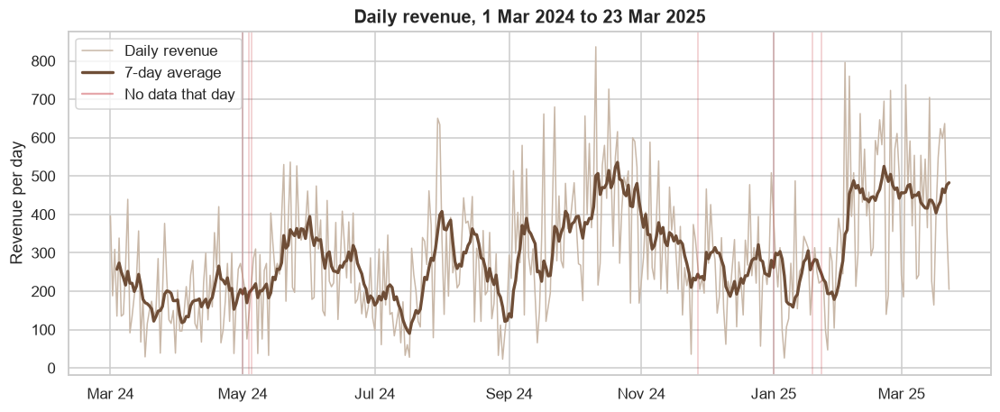
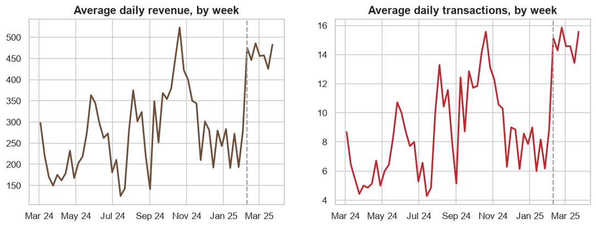
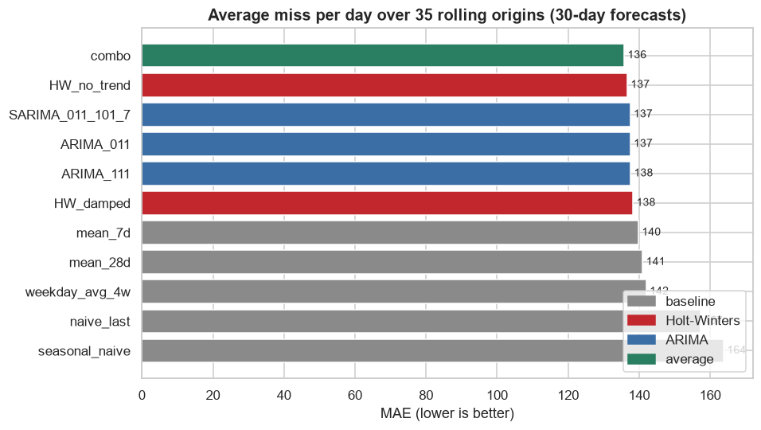
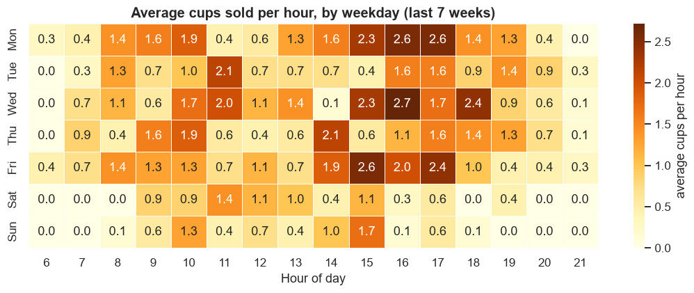

# Coffee Sales Forecasting

Forecasting daily coffee-shop sales with Excel and Python, tested honestly with rolling backtests.

 **[Live dashboard](https://coffee-sales-forecasting-zbha9jfqwanpgk5gih8qzp.streamlit.app/)**                  

> **Historical exercise.** The data ends on 23 Mar 2025, so the forecast window (24 Mar to 22 Apr 2025) is in the past. This is a portfolio project, not a live business forecast. The source file does not state a currency, so revenue is shown as plain numbers.

## Questions

1. How do sales change by day, weekday, hour and product?
2. Can Holt-Winters or ARIMA forecast the next 30 days better than very simple methods?
3. What should a shop owner prepare, and when?

## Data

`data/raw/Coffe_sales.csv`: 3,547 card transactions, 1 Mar 2024 to 23 Mar 2025 (388 calendar days).
Columns include time of sale, coffee name, price paid ("money"), hour, weekday and time of day.

## Project structure

```
coffee-sales-forecasting/
├── data/
│   ├── raw/Coffe_sales.csv
│   └── processed/daily_sales.csv
├── notebooks/
│   ├── 01_data_cleaning_and_eda.ipynb
│   ├── 02_baseline_models.ipynb
│   ├── 03_holt_winters_and_arima.ipynb
│   ├── 04_backtesting_and_comparison.ipynb
│   └── 05_product_forecast_and_recommendations.ipynb
├── app/dashboard.py
├── excel/Coffee_Sales_Forecasting.xlsx
├── outputs/
│   ├── figures/
│   └── tables/
├── requirements.txt
└── README.md
```

| Notebook | What it does |
|---|---|
| 01 | Data checks, daily table, patterns by weekday, hour and product, the volume jump in Feb 2025 |
| 02 | Simple baseline forecasts that every model must beat |
| 03 | Holt-Winters and ARIMA/SARIMA, residual checks, interval check |
| 04 | 35 rolling backtests of 11 methods, fair comparison, final forecast range |
| 05 | Product-level forecast range, peak times, daily prep guide |

The **Streamlit dashboard** (`app/dashboard.py`) shows the same results interactively: overview, patterns, forecast range, backtest and recommendations.

The **Excel workbook** repeats the work with live formulas: Holt-Winters with Solver, a dashboard, a 30-day backtest, product forecast and recommendations.

## Key findings

**Data**
- No duplicates or missing values. 7 calendar days have no sales; they are flagged, not filled with zero.
- Average revenue per day rose from about 240 to 461 around the week ending 9 Feb 2025. The cause is **more sales per day (+96%), not higher prices**. The data cannot say why.
- Strongest weekday since the jump: Monday; weakest: Sunday. Peak hour overall: 10:00 (9.1% of revenue). Top product: Latte (23.9% of revenue).

**Forecasting (35 rolling 30-day backtests)**

| Method | MAE per day | WAPE |
|---|---|---|
| Average of 3 forecasts (combo) | 135.7 | 42% |
| Holt-Winters (no trend) | 136.6 | 43% |
| ARIMA (0,1,1) | 137.5 | 43% |
| 7-day average (simple baseline) | 139.8 | 44% |
| Same weekday last week | 163.8 | 51% |

- Holt-Winters, ARIMA and the combination are about **16-17% better** than "same weekday last week", but only **2-3% better** than a plain 7-day average. That gap is small next to the day-to-day noise.
- In the **last 30 days alone**, a weekday average beat every statistical model by a wide margin (MAE 76 vs 130-170). One window can mislead, which is why 35 windows are used.
- Over one day ahead, Holt-Winters is clearly better than the baselines. Over 30 days the advantage mostly disappears.
- The weekly pattern is weak (autocorrelation 0.37 at lag 7); most of the structure is a slowly drifting level.
- Daily percentage errors are very high (SMAPE about 48%) because some days have very low sales. WAPE and MAE are used for comparison.
- ARIMA's 95% interval covered 91% of test days.

**Recommendations (last 7 weeks, from notebook 05)**
- A weekday sells about 18 cups and a weekend day about 8. Staff and order for weekdays.
- Busiest hours: 15:00, 17:00, 16:00 and 10:00.
- Mornings lean towards Americano; nights towards Cocoa.
- The product mix is **not stable** (Americano's monthly share ranges over 21 percentage points), so the product split is only a rough guide.
- Plan with a range between methods, not one number.

## Key charts

**Daily revenue and the level shift in Feb 2025**




**Which method forecasts best? (35 rolling backtests)**



**When is the shop busiest? (weekday x hour)**



## Limitations

- Only 13 months of data: yearly seasonality cannot be measured.
- One large level shift in Feb 2025 whose cause is unknown.
- No stock, waste or staffing data, so the recommendations are starting points, not optimised plans.
- Product forecasts split the total by recent revenue share; they are not separate models.

## How to run

```bash
git clone https://github.com/Bilaldataorbit/coffee-sales-forecasting.git
cd coffee-sales-forecasting
python -m venv venv
venv\Scripts\activate          # Windows (PowerShell)
pip install -r requirements.txt
jupyter lab
```

Run the notebooks in order (01 to 05), then start the dashboard:

```bash
streamlit run app/dashboard.py
```

Each notebook saves its charts to `outputs/figures` and tables to `outputs/tables`. Notebook 04 takes about a minute and shows a progress counter.

## Tools

Python (pandas, NumPy, SciPy, statsmodels, matplotlib, seaborn, Plotly, Streamlit), Jupyter, Excel (formulas, Solver, charts).

## Author

Bilal Raza · [GitHub](https://github.com/Bilaldataorbit)
